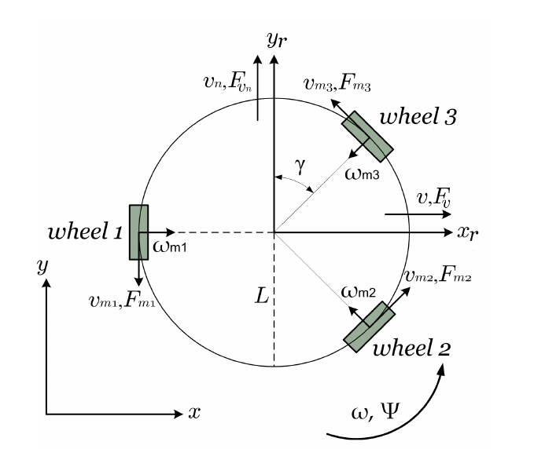
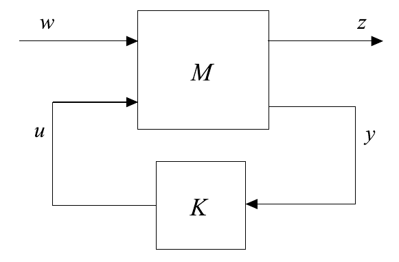

# hinfinity_project
This repository is a Python implementation of my capstone project, [Controle Hinf por Realimentação de Estados Aplicado a um Robô Omnidirecional](assets/TFG_Cezar_Lemos.pdf) (state-feedback H∞ control applied to an omnidirectional robot, in Portuguese), originally developed in MATLAB. The code differs slightly from the original work in a few details, such as the sampling period and some robot parameters.

## Running the App

The project is presented as a Streamlit app with a theory page and an interactive simulation page, where you can draw a path and watch the robot follow it.

Dependencies are managed with [uv](https://docs.astral.sh/uv/):

```bash
uv sync
uv run streamlit run home_page.py
```

`ffmpeg` must be installed to generate the simulation videos.

Alternatively, with Docker:

```bash
docker build -t hinfinity .
docker run -p 8080:8080 hinfinity
```

and open http://localhost:8080.

## Robot



The robot parameters and its state-space representation are defined in `src/system_data.py`.

## Controller Design



`src/project.py` contains the functions that compute the H∞ controller, with pole placement in a disk, for a system in the generalized form.

A set of controllers for a grid of disk centers and radii can be computed with:

```bash
uv run python cli.py multiproject -o data/controllers.json -c 0.1 -r 0.1
```

## Simulation

The notebook `evaluation_SCS.ipynb` analyzes the controllers designed with the SCS solver, selects one and runs simulations with it.
